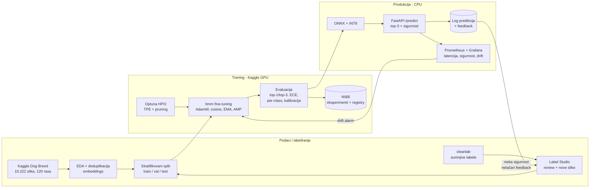

# Prepoznavanje rase psa — KupujemProdajem AI zadatak

Korisnik pošalje fotografiju psa → sistem vraća **3 najverovatnije rase** (od 120) sa kalibrisanim verovatnoćama.
Model je dovoljno mali da radi brzo na običnom CPU-u, a sistem pokriva ceo životni ciklus:
labeliranje → trening → evaluacija → HPO → produkcija + monitoring → kontinualno unapređivanje.

> Plan rada po danima: [`docs/PLAN.md`](docs/PLAN.md) · Priprema za intervju: [`docs/INTERVIEW.md`](docs/INTERVIEW.md)

## Arhitektura sistema



## Brzi start (Windows, lokalno — bez GPU-a)

```powershell
python -m venv .venv
.venv\Scripts\activate
pip install -r requirements.txt

# 1) proveri da ceo pipeline radi (lažni podaci, CPU, ~1 min)
python -m pytest -q

# 2) koliko su kandidati brzi NA TVOM laptopu (bez treninga)
python scripts/benchmark_candidates.py --threads 4
```

## Trening na Kaggle-u (besplatni GPU)

1. Kaggle nalog → verifikuj telefon (otključava GPU i internet u notebook-u).
2. Otvori [Dog Breed Identification](https://www.kaggle.com/c/dog-breed-identification) → *Late Submission / Join* da prihvatiš pravila.
3. New Notebook → *Add Input* → takmičenje `dog-breed-identification` → *Settings*: Accelerator **GPU T4/P100**, Internet **On**.
4. Ćelije:

```bash
!git clone https://github.com/<tvoj-username>/kp-dog-breeds.git
%cd kp-dog-breeds
!pip install -q "timm>=1.0.15" optuna wandb cleanlab onnx onnxruntime
!ls /kaggle/input                      # proveri putanju i ispravi configs/kaggle.yaml ako treba
!python -m dogbreeds.data  --config configs/kaggle.yaml
!python -m dogbreeds.train --config configs/kaggle.yaml
!python -m dogbreeds.evaluate --config configs/kaggle.yaml --checkpoint /kaggle/working/runs/<run>/best.pt
!python -m dogbreeds.export   --config configs/kaggle.yaml --checkpoint /kaggle/working/runs/<run>/best.pt --out /kaggle/working/artifacts --int8
```

5. Preuzmi `artifacts/` (model.onnx + model.json) i testiraj lokalno:

```powershell
python -m dogbreeds.inference artifacts\model.onnx moj_pas.jpg
```

## Struktura

```
configs/            baseline.yaml (svi hiperparametri), kaggle.yaml (putanje)
dogbreeds/
  data.py           split (stratifikovan / grupisan), Dataset, timm transformacije
  model.py          timm model, param grupe, zamrzavanje backbone-a
  train.py          trening petlja (+ Optuna hook za pruning)
  metrics.py        top-k, log-loss, ECE, temperature scaling
  evaluate.py       test metrike, per-class, confusion parovi, kalibracija
  export.py         ONNX, INT8 kvantizacija, benchmark
  inference.py      produkcioni Predictor (bez torch-a)
scripts/            dummy podaci, benchmark kandidata, ONNX evaluacija
tests/              smoke test celog pipeline-a + paritet preprocessing-a
docs/               PLAN.md, INTERVIEW.md
```

## Rezultati

| Model | Param | Val top-1 | Test top-1 | Test top-3 | ECE (kal.) | CPU p95 (INT8) |
|---|---|---|---|---|---|---|
| _popuni posle Dana 2-5_ | | | | | | |

## Poznata ograničenja (i šta bih radio dalje)

- **Curenje iz ImageNet-a:** Kaggle/Stanford Dogs slike potiču iz ImageNet-a, na kome su pretrenirani i naši modeli → interne metrike su verovatno optimistične. Zato postoji i spoljni test skup (vidi PLAN, Dan 3).
- **Mešanci i slike koje nisu psi:** model zna samo 120 rasa; za nisku sigurnost vraća "nisam siguran" umesto pogrešne tvrdnje.
